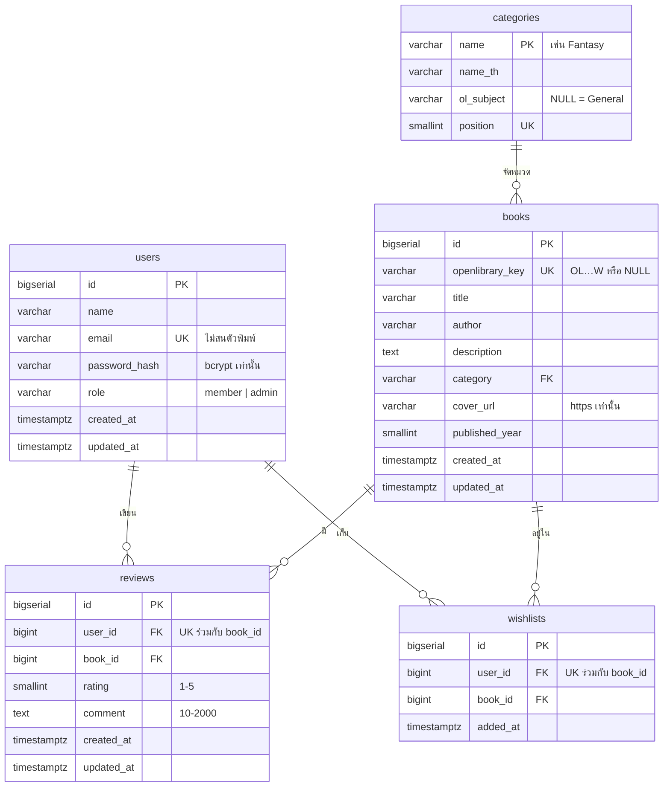

# Book Review Database Schema

PostgreSQL 15+ (Supabase) โครงเดียวกับ `moviehub/schema.sql` ของ week6-lab ปรับจากหนังเป็นหนังสือ

| ไฟล์ | ใช้ทำอะไร |
|---|---|
| [`schema.sql`](../schema.sql) | ตาราง + view + index + เปิด RLS + หมวดหมู่ 9 หมวด รันครั้งเดียวบนฐานข้อมูลว่าง |
| [`seed.sql`](../seed.sql) | หนังสือตั้งต้นจาก Open Library (สร้างด้วย `make-seed.mjs`) รันซ้ำได้ |
| [`make-seed.mjs`](../make-seed.mjs) | ดึงหนังสือหมวดละ 10 เล่มจาก Open Library แล้วเขียน `seed.sql` (Node 18+ ไม่ต้องติดตั้งอะไร ไม่ต้องใช้ key) |
| [`promote-admin.sql`](../promote-admin.sql) | เลื่อนบัญชีที่สมัครแล้วเป็น admin ด้วยอีเมล ไม่มีรหัสผ่านในไฟล์ |
| [`db-test.sql`](../db-test.sql) | ทดสอบ constraint 29 ข้อใน transaction แล้ว ROLLBACK ข้อมูลไม่เปลี่ยน |

```bash
psql "$DATABASE_URL" -f schema.sql
node make-seed.mjs          # เขียน seed.sql ใหม่จาก Open Library (ต้องต่ออินเทอร์เน็ต)
psql "$DATABASE_URL" -f seed.sql
psql "$DATABASE_URL" -f db-test.sql
```

## 1. ตารางและความสัมพันธ์



| ตาราง | กติกาที่ฐานข้อมูลบังคับ |
|---|---|
| `users` | อีเมลห้ามซ้ำแบบไม่สนตัวพิมพ์ (`uq_users_email`), `password_hash` ต้องเป็นรูปแบบ bcrypt (กันเก็บรหัสผ่านตรง ๆ), `role` เริ่มต้น `member` และเป็นได้แค่ `member` / `admin` |
| `books` | `openlibrary_key` UNIQUE และต้องตรงรูปแบบ `OL\d+W` (NULL ได้หลายแถว = หนังสือที่ admin เพิ่มเอง), `category` → `categories.name` (ON UPDATE CASCADE, ลบหมวดที่มีหนังสือไม่ได้), `cover_url` ต้องขึ้นต้น `https://`, `published_year` 1–2100 |
| `reviews` | `rating` 1–5, `comment` 10–2000 ตัวอักษร, 1 คนรีวิว 1 เล่มได้ครั้งเดียว `UNIQUE(user_id, book_id)`, ลบผู้ใช้หรือหนังสือแล้วรีวิวหายตาม (CASCADE) |
| `wishlists` | `UNIQUE(user_id, book_id)` เพิ่มซ้ำไม่ได้, ลบผู้ใช้หรือหนังสือแล้วหายตาม |
| `book_rating_stats` (view) | `review_count` และ `avg_rating` (ทศนิยม 1 ตำแหน่ง) ต่อเล่ม คำนวณสดจาก `reviews` (แนวเดียวกับ `movie_vote_stats`) |

ต่างจาก MovieHub: ไม่มีตาราง `votes` แยก เพราะโจทย์ให้คะแนนอยู่ใน `reviews.rating` (สเกล 1–5 แสดงเป็นดาวได้ตรง ๆ)

## 2. Open Library กับตาราง books

| สถานการณ์ | เกิดอะไรขึ้น |
|---|---|
| Guest เปิดหน้ารายการหรือค้นหนังสือ | หน้าเว็บเรียก Open Library ตรง (`openlibrary.js`) ไม่ผ่าน Go |
| เปิดหน้ารายละเอียด `/books/OL27448W` | หน้าเว็บถาม `GET /api/books/OL27448W/reviews` ถ้า `bookId` เป็น `null` แปลว่ายังไม่มีในตาราง ใช้ข้อมูลจาก Open Library แสดง |
| สมาชิกรีวิวหรือเพิ่ม wishlist หนังสือที่ยังไม่มีในตาราง | Go ดึง `/works/{key}.json` + `search.json` จาก Open Library **เอง** (ไม่เชื่อข้อมูลหนังสือจากหน้าเว็บ) แล้ว `INSERT … ON CONFLICT (openlibrary_key) DO NOTHING` ก่อนสร้างรีวิว กดพร้อมกันหลายคนก็ได้แถวเดียว |
| หมวดของหนังสือที่นำเข้า | ดูจาก `subjects` ของ Open Library เทียบกับ `categories.ol_subject` ตามลำดับหมวด ถ้าไม่ตรงใช้หมวดที่ผู้ใช้เปิดดูอยู่ (ต้องมีจริง) ถ้าไม่มีอีกใช้ `General` |
| admin เพิ่มหนังสือ | กรอกเอง หรือค้นจาก Open Library ในฟอร์มให้เติมข้อมูล `openlibrary_key` ใส่หรือไม่ใส่ก็ได้ |

| Open Library | คอลัมน์ | กติกา |
|---|---|---|
| `key` `/works/OL27448W` | `openlibrary_key` `OL27448W` | |
| `title` | `title` | ตัดที่ 255 ตัว |
| `author_name[]` (search) หรือ `/authors/{id}.json` | `author` | ต่อด้วย `, ` สูงสุด 3 คน ไม่มีเลย `Unknown author` |
| `first_publish_year` (search) หรือ `first_publish_date` (works) | `published_year` | นอกช่วง 1–2100 เป็น NULL |
| `covers[0]` หรือ `cover_i` | `cover_url` | `https://covers.openlibrary.org/b/id/{id}-L.jpg` |
| `description` (string หรือ `{ type, value }`) | `description` | ตัดส่วน "See also" และลิงก์ markdown ยาวเกิน 5000 ตัด |

`seed.sql` ใช้ `ON CONFLICT (openlibrary_key) DO NOTHING` (MovieHub ใช้ DO UPDATE เพราะ TMDB เป็นต้นฉบับ แต่ที่นี่ฐานข้อมูลเราเป็นต้นฉบับหลังนำเข้า รันซ้ำจึงต้องไม่ทับข้อมูลที่ admin แก้)

## 3. สัญญาชื่อฟิลด์ DB → JSON (Go และ React ใช้ชื่อเดียวกัน)

camelCase ทั้งหมด, list ตอบ `{ "items": [...] }` (แบ่งหน้าเพิ่ม `total`, `page`, `pageSize`), error ตอบ `{ "error": { "code", "message" } }`

| คอลัมน์ | JSON |
|---|---|
| `books.id, openlibrary_key, title, author, description, category, cover_url, published_year, created_at` | `id, openlibraryKey, title, author, description, category, coverUrl, publishedYear, createdAt` |
| `book_rating_stats.avg_rating, review_count` | `avgRating` (null = ยังไม่มีรีวิว), `reviewCount` |
| `wishlists.added_at` | `addedAt` (เฉพาะ `GET /api/wishlist`) |
| `users.id, name, email, role, created_at` | `id, name, email, role, createdAt` (`password_hash` ไม่มีวันส่งออก: `json:"-"`) |
| `reviews.id, user_id, book_id, rating, comment, created_at, updated_at` | `id, userId, bookId, rating, comment, createdAt, updatedAt, user: { id, name }` (+ `book: { id, title, openlibraryKey }` ในหน้า admin) |
| `categories.name, name_th, ol_subject` | `name, nameTh, olSubject` |

หนังสือจาก Open Library ในหน้าเว็บ (`openlibrary.js` → `toBook`) ใช้รูปร่างเดียวกัน โดย `id` = รหัส Open Library ลิงก์ `/books/{id}` จึงใช้ได้ทั้ง 2 แหล่ง

## 4. Error ของ PostgreSQL → HTTP

| SQLSTATE | เกิดเมื่อ | Go ตอบ |
|---|---|---|
| `23505` unique | อีเมลซ้ำ / รีวิวเล่มเดิมซ้ำ / `openlibrary_key` ซ้ำ | 409 `EMAIL_TAKEN` / `ALREADY_REVIEWED` / `BOOK_EXISTS` |
| `23503` foreign key | หนังสือไม่มีจริง / หมวดไม่มีจริง | 404 `BOOK_NOT_FOUND` / 400 `BAD_CATEGORY` |
| `23514` check | ข้อมูลผิดรูปแบบ | Go ตรวจเองและตอบ 400 ก่อนถึง DB ทุกกรณี CHECK เป็นด่านสุดท้าย |
| `UPDATE`/`DELETE` ได้ 0 แถว | ไม่มีรีวิวนี้ หรือไม่ใช่ของผู้เรียก | 404 (ไม่บอกว่ามีอยู่แต่เป็นของคนอื่น) |

## 5. Admin คนแรก

ไม่มีรหัสผ่านหรือบัญชีสำเร็จรูปใน `schema.sql`, `seed.sql` หรือ git และสมัครผ่าน API ได้ role `member` เสมอ

1. สมัครบัญชีผ่านหน้า Register (Go แปลงรหัสเป็น bcrypt เอง)
2. `psql "$DATABASE_URL" -v email='you@example.com' -f promote-admin.sql`
   หรือบน Supabase SQL Editor: `UPDATE users SET role = 'admin', updated_at = now() WHERE lower(email) = lower('you@example.com') RETURNING id, name, email, role;`
3. ออกจากระบบแล้วเข้าใหม่ (role อยู่ในตั๋ว JWT ใบเดิม หมดอายุภายใน 1 ชั่วโมง)

## 6. Supabase

- `schema.sql` เปิด Row Level Security ทุกตารางโดยไม่มี policy: anon key ของ Supabase อ่านเขียนตารางไม่ได้เลย Go ต่อในฐานะเจ้าของตาราง (`postgres`) จึงทำงานปกติ ทุกคำขอต้องผ่าน Go ที่ตรวจสิทธิ์แล้ว
- view `book_rating_stats` ใช้ `security_invoker` จึงไม่เป็นช่องให้ข้าม RLS
- Connection string อยู่ที่ Render (`DATABASE_URL`) เท่านั้น ห้ามใส่ใน frontend หรือ Vercel
